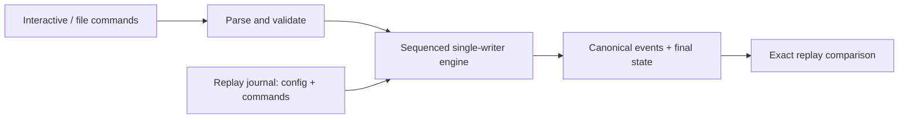

# High-Performance Trading Simulator

[](https://github.com/ThePhysic/high-performance-trading-simulator/actions/workflows/ci.yml)

A Linux-oriented **C++20 event-processing and exchange simulator** with one authoritative book writer, deterministic commands, and synthetic accounts/orders. It runs entirely from a terminal; native MSVC builds are also supported.

The engineering focus is price-time/FIFO matching, coherent risk/accounting invariants, exact replay, bounded backpressure, and a measured formatting optimization that preserves every canonical output byte.

## Measured serialization optimization

Replacing stream-based canonical formatting with direct string appends and integer `to_chars` improved these recorded **synthetic, direct-mode, in-process** results. The matching algorithm did not change.

| Profile | Baseline commands/s | Candidate commands/s | Ratio |
|---|---:|---:|---:|
| crossing | 331,669 | 548,819 | 1.655× |
| cancel | 403,400 | 770,497 | 1.910× |
| mixed | 396,486 | 677,853 | 1.710× |

Means of **five interleaved measured repetitions per implementation**, 100,000 commands/run, seed 42, GNU C++ 15.2 `RelWithDebInfo` (`-O2 -g -DNDEBUG`, frame pointers), Ubuntu 26.04 under WSL2, AMD Ryzen 9 7940HS. The timed interval includes processing, canonical serialization, and trace hashing; it excludes input parsing, final-state generation, network transport, and durable output. The shared host was not isolated or pinned. These are not live-feed results, bare-metal latency guarantees, or universal speedups.

[Experiment and tradeoffs](reports/linux/SERIALIZATION_EXPERIMENT.md) · [Raw samples and variability](reports/linux/serialization-comparison.json) · [Timing boundaries](docs/PERFORMANCE.md)

## Build, test, and replay

Prerequisites: CMake 3.20+, a C++20 compiler, thread support, and Python 3.10+. From a fresh Linux checkout:

```sh
git clone https://github.com/ThePhysic/high-performance-trading-simulator.git
cd high-performance-trading-simulator
cmake -S . -B build/debug -DCMAKE_BUILD_TYPE=Debug -DBUILD_TESTING=ON
cmake --build build/debug --parallel 2
ctest --test-dir build/debug --output-on-failure

mkdir -p build/demo
./build/debug/hpts run --config examples/accounts.cfg --input examples/demo.commands --output build/demo/events.txt --state build/demo/state.txt --journal build/demo/journal.txt
./build/debug/hpts replay --journal build/demo/journal.txt --expect build/demo/events.txt --expect-state build/demo/state.txt
./build/debug/hpts interactive --config examples/accounts.cfg
```

The recorded demo output is:

```text
processed=22 trace_digest=2fd7789a4a51cdad state_digest=994dfc9066d8a373
replay verified: commands=22 trace_digest=2fd7789a4a51cdad state_digest=994dfc9066d8a373
```

The 22 commands exercise partial fills/FIFO, replacement, cancellation, risk rejection, and kill-switch transitions. Replay checks exact event/state bytes and a complete journal containing configuration, ordered commands, and a completion footer. Output files are overwritten; keep generated work under ignored `build/` directories. [Full command reference](docs/USAGE.md).

## How it works



File and interactive modes execute directly. Queued benchmarks put bounded ingress and egress handoffs around the same writer and serializer. Queues use **mutexes and condition variables**; full queues apply blocking backpressure.

- Ordered price maps select the best price; per-price FIFO lists preserve time priority. Order-ID lookup is `O(log N)`, and removal of a known FIFO node is `O(1)`.
- Risk reservations and match effects are prepared before domain-state commit; invalid replacements preserve the original order and priority.
- Identity ledgers never evict IDs. Explicit capacity rejections bound finite sessions, with the exact policy documented in [Design](docs/DESIGN.md).
- One book writer makes ordering and ownership inspectable. Specialized lock-free matching and custom allocators were not needed to establish these behaviors.

## Correctness and verification

The existing CTest targets check matching/risk contracts against an independent reference model, 16 seeds × 1,200 stateful commands with invariants, exact replay, integer/escaping extremes, bounded queues with 8,000 concurrent items, and CLI failures including malformed inputs and broken output streams.

Recorded Linux Debug/Release, ASan/UBSan, TSan, and native MSVC Release results are retained in the [validation record](reports/VALIDATION.md). Hosted checks run through [GitHub Actions](https://github.com/ThePhysic/high-performance-trading-simulator/actions/workflows/ci.yml); their current results are separate from the recorded performance experiment. [CI configuration](.github/workflows/ci.yml).

## Boundaries

One simulated instrument (`SIM`), integer tick prices/unit quantities, and synthetic balances. **No live trading, real funds, profitability claims, network ingress, or durable crash recovery.** No guaranteed throughput/latency or production-exchange certification. There is no frontend, strategy research, or cloud service.

## Documentation

| Document | Purpose |
|---|---|
| [Usage](docs/USAGE.md) | Build, terminal commands, configuration, journal/replay, and errors |
| [Design](docs/DESIGN.md) | Matching/risk rules, ownership, capacities, atomicity, and canonical schema |
| [Performance](docs/PERFORMANCE.md) | Metric boundaries, workload methodology, and Linux profiling |
| [Tooling](tools/README.md) | Generator, benchmark suite, and validation helper options |
| [Validation](reports/VALIDATION.md) | Actual verification evidence and known limitations |
| [CI](docs/CI.md) | Hosted build/test matrix and status links |

[Public scope](GOAL.md) · [Historical requirements](docs/requirements/README.md)
